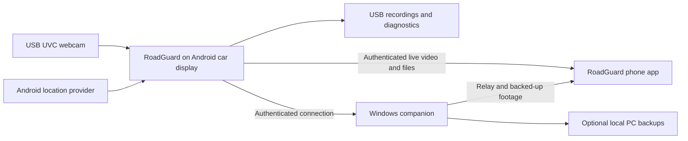

# RoadGuard

### Turn your existing Android car display and USB webcam into a connected dashcam

RoadGuard records journeys to USB storage and lets paired phones and a Windows companion view live video, browse saved footage and see the car's available GPS location. It is built for drivers who want to reuse equipment they already own and keep control of their recordings.

**Current development release · 0.7.0-alpha · Android 6.0+ · Windows companion**

Read the [complete feature and architecture guide](docs/FEATURES.md) for automatic hardware selection, Android-version behavior, every application module, operating limits and troubleshooting.

RoadGuard is an open-source project that can reduce the need to buy a separate dashcam when a compatible Android head unit, UVC webcam and USB drive are already available. Original RoadGuard code is available under Apache License 2.0. The current application has no implemented subscription or cloud-storage billing requirement. Hardware, electricity, internet/mobile data and any third-party network service remain separate costs. Camera quality, stereo performance and USB compatibility determine the result.

## What you can do

| Feature | How it helps |
| --- | --- |
| Continuous USB recording | Keep footage on removable storage and review it on your own devices. |
| Small recording segments | Reclaim old footage incrementally as storage fills. |
| Recording health | See saved-byte progress, camera frame rate, storage space and recording status. |
| Recovery and retries | Retry camera detection and recover completed fragments after interrupted writes. |
| Timestamp in the picture | New video carries the car's local day, date, time to seconds and UTC offset through recording, streaming and download. |
| Encoded live video | Share H.264 video with paired viewers and use full-screen viewing. Actual smoothness depends on camera, processor and connection. |
| Phone and Windows access | Browse recordings and download footage through authenticated connections. |
| Date and time selection | Choose a whole day or a start/end time, then play or export the available footage. |
| Playback controls | Review selections at 1×, 2× or 3×. Exported video retains normal speed. |
| Location display | View available coordinates, reported accuracy, freshness and a map. Stale fixes are labelled. |
| Optional PC backup | Copy completed clips within a configured limit and resume interrupted transfers. |
| Offline image adjustment | Apply restrained shadow brightening using lightweight scene analysis on the car. |
| Remembered pairing | Reuse approved device credentials and reconnect when the saved endpoint and network are available. |

## How it works



The car processes and records the camera video. Android's available H.264 encoder supplies the live stream as well as recording. The app checks capabilities and can lower its quality profile under sustained performance pressure.

Car and phone use the same APK with different roles. On the same hotspot or Wi-Fi, paired devices use local connections. Access between different networks requires a configured private network such as Tailscale and internet access on the participating devices. Tailscale setup and Android VPN approval are separate first-time steps. A Windows PC providing relay or backup access must be powered on and reachable.

## Why reuse existing equipment?

- An existing car display provides the screen and processor.
- A compatible webcam provides the video input.
- A removable USB drive holds the recording library.
- A phone provides a portable live viewer and footage browser.
- An existing Windows PC can provide a dashboard and optional backup storage.
- Local recording and image adjustment continue without an internet connection once the camera and storage are ready.

This can make basic dashcam recording affordable without purchasing a complete dedicated camera system. Dedicated automotive cameras may offer capabilities that this setup cannot reproduce, including purpose-designed optics, heat tolerance, parking power management and hardware-backed night imaging. RoadGuard's alpha release needs testing with each hardware combination before relying on its recordings.

## Automatic adaptation to your Android hardware

One APK packages native libraries for **32-bit ARM, 64-bit ARM, x86 and x86-64**. Android selects the compatible ABI when installing and loading the app. RoadGuard then chooses a camera/encoder quality profile using the device's reported capabilities and current available resources. Android API checks select supported operating-system behavior.

The quality planner reads total RAM, available RAM, CPU core count, Android low-memory state, thermal status where available, and advertised hardware H.264 encoding support at 30 FPS. The initial ceilings are evaluated in this order. Memory figures below are MiB as calculated by the implementation.

| Device conditions | Initial resolution ceiling |
| --- | --- |
| Low-memory warning, severe thermal status, or less than 256 MiB currently available | 640 × 480 |
| At least 3500 MiB total RAM, 768 MiB available, 4 cores and advertised hardware 1080p/30 surface-input encoding | 1920 × 1080 |
| At least 1500 MiB total RAM, 384 MiB available, 2 cores and advertised hardware 720p/30 surface-input encoding | 1280 × 720 |
| Remaining devices | 640 × 480 |

The camera's advertised sizes can lower the result. The ordered candidates use MJPEG, with a final 640 × 480 YUYV fallback. Encoder startup tries 30 FPS and then 15 FPS, plus alternative advertised codecs when needed. Available memory means memory free for use at that moment, so applications already running on the stereo can affect the choice.

After a 30-second warm-up, 20 consecutive seconds of low preview FPS, Android low-memory state or severe thermal pressure can lower a higher-resolution profile. After at least 60 seconds without current pressure and with video fragments committed, the selected profile can be remembered for that firmware, camera and candidate list. **RETEST AUTO QUALITY (STOP FIRST)** clears that learned preference.

This gives older hardware a lighter starting configuration and allows capable devices to try higher quality. These are bounded heuristics with fallbacks. They select a workable configuration to test rather than guaranteeing the mathematically best setting. The current session does not continually step quality upward. Actual resolution and preview FPS are shown in the app. The [detailed adaptation guide](docs/FEATURES.md#automatic-hardware-and-version-selection) explains the sequence and its limits.

## Watch live on your phone and PC

The Android car app encodes the webcam picture once and makes the resulting H.264 video available to authorised viewers. A paired phone decodes it in the RoadGuard app. The Windows dashboard opens its live player. Full-screen and fit/fill controls help use different screen shapes.

On a shared hotspot, video travels across the local network. At another location, the viewer needs a reachable private-network route to the car or the configured Windows companion. The Windows companion can relay live video and serve its completed backups while it is running. PC backups remain available through that PC when the car is offline. Current camera video requires the car, camera and connection to be active.

Live transport supports up to two direct car viewers, bounds its queues and drops stale queued frames when a viewer falls behind. Background PC backups pause while that PC is serving live video. Those measures reduce competition and accumulated delay. The delivered frame rate depends on the webcam, encoder, stereo temperature and network bandwidth. Reconnection can resume after interruptions when the paired device becomes reachable again.

## Follow the car's live location

Enable location sharing on the car and approve Android location access. The app reports available coordinates, the receiver's accuracy estimate and when the fix was captured. Phone and Windows views can display the position on a map and refresh available location information. Place names depend on available geocoding services.

Fresh fixes move the map position as the vehicle travels. If GPS reception or connectivity stops, the last received position is labelled with its age so the viewer can distinguish it from a fresh fix. Refresh requests a fresh available fix. Satellite reception, antenna placement and the head unit's GPS hardware determine how precisely it follows the car.

For viewing from a different location, both ends need internet and a working private-network connection. Location sharing is intended for the owner and approved devices. The car must remain powered and able to report fixes for ongoing tracking.

## Hardware and first setup

You need an Android 6.0/API 23 or newer device with working USB host support, a supported UVC USB camera and writable removable storage. USB port count, bus bandwidth and available power matter when the camera and storage share a hub. The current recorder uses USB cameras. Factory RCA reverse cameras require manufacturer-specific access and are outside the current capture implementation.

1. Install a matching RoadGuard APK on the car and phone. Choose the Car and Phone roles respectively.
2. Approve Android's requested camera and USB access and connect the storage drive.
3. Check the car's clock and time zone. Start recording and confirm that saved bytes increase.
4. Connect the phone and car through the same hotspot or Wi-Fi. Open Connect Phone on the car and pair using its QR/code flow.
5. For Windows, extract a matching companion package and run `Setup.cmd`. Pair the car and configure backup preferences.
6. For remote access, configure the private VPN on the relevant devices and use the reachable private address in pairing. Enable supported auto-connect settings after initial setup.

Saved credentials support reconnection. Android permissions, OEM startup restrictions, network availability and VPN sign-in still affect whether reconnecting succeeds. Android requires the APK to be installed before it runs.

See the [setup and parked-test guide](outputs/RoadGuard-0.7.0-Guide.md) for the verification sequence.

## Recording and storage

New footage is written beneath the removable volume's app folder at `Android/data/com.roadguard.ai/files/RoadGuardAI/Car Dash Cam Recordings/`. Filenames include the car's date, weekday and start time. New segments normally rotate near 32 MiB or five minutes at a keyframe. The timeline can present or export several segments as one selected day or time range.

Video fragments are committed at approximately one-second intervals. Recovery can retain completed fragments after an unexpected power cut. The final unfinished fragment or data still buffered by the USB controller can be lost.

The free-space reserve is 3 decimal GB on an 8 GB drive and 10 decimal GB on drives of 24 GB or larger, including common 32/64/128 GB sizes. Smaller drives use a reserve no larger than half their capacity. Cleanup starts with a write margin and removes at most one eligible oldest finished segment per check, approximately every five seconds.

Active recordings, kept videos, exports, unrelated files and legacy clips larger than 64 MiB are excluded from automatic deletion. When eligible clips cannot provide enough space, recording pauses and can resume after space becomes available. Other applications can consume the reserved space.

Grouped writes, a `.nomedia` marker and paced background backup reads aim to reduce contention when songs share the USB drive. Music playback still depends on the stick, shared USB hardware and the stereo's music player.

## Offline night enhancement

While the encoder is running, the app meters a small image sample approximately every three seconds. Local clustering estimates brightness and colour, then a bounded GPU adjustment lifts visible shadows. Stronger night processing is available from 18:00 to 06:00 by the car clock. Daylight processing is limited to high-contrast scenes.

The adjustment avoids nearly black and monochrome scenes. It is disabled at measured frame rates of 1–9 FPS and when the camera's reported name suggests native night processing. Users can select **Use camera's own night processing only** for cameras that cannot be recognised automatically.

This release provides modest shadow adjustment. Detail in complete darkness requires suitable camera hardware and illumination. The module does not guarantee clearer moving number plates, noise-free video or infrared capability.

## Find and export footage

Choose a date, then **Full day** or a start/end minute. Playback skips gaps where no footage exists. The selection uses the car's clock, and the end time is exclusive. New footage keeps its embedded timestamp when exported.

- On the phone, the app reads available saved clips through the paired connection and prepares an MP4 before the user selects a download destination.
- On the car, stop and save before local playback/export. Finished exports go to the USB `RoadGuardAI/Exports` folder.
- On Windows, the timeline works with completed PC backups of the paired car. Back up the required clips first.

Phone and Windows exports need temporary storage. Whole-day processing can take time. Keep important source footage before a long export so automatic cleanup cannot remove it. Older unindexed recordings may require Windows playback or export.

## Location and privacy

GPS comes from Android's available location provider. Permission, a working receiver and reception affect accuracy. The app displays reported accuracy and the age of the fix. A map can only show the location data that the car supplies.

Pairing uses device identity, certificate pinning and revocable access credentials. Location sharing is optional. Settings and identity keys use Android application storage and Keystore. Car recording media and diagnostics use USB storage. Map tiles and place information may require external network services.

## Build from source

The directory layout follows the existing development project.

| Directory | Contents |
| --- | --- |
| `work/RoadGuardAI/` | Android app, USB camera modules and Android/host tests |
| `work/RoadGuardWindows/` | Windows dashboard, Node server, installer and tests |
| `outputs/` | Selected setup and validation documents |

Configure an Android SDK with platform 36, NDK `28.1.13356709` and CMake `3.22.1`, plus a JDK compatible with the checked-in Gradle wrapper. Set `ANDROID_SDK_ROOT` or create a local, untracked `local.properties` file. Then run from the repository root on Windows.

```powershell
.\work\RoadGuardAI\gradlew.bat -p .\work\RoadGuardAI :app:assembleDebug :app:lintDebug
```

The APK is generated in `work/RoadGuardAI/app/build/outputs/apk/debug/`. A fresh checkout creates a local development signing identity. Updating an existing install requires its original signing identity.

The Windows dashboard uses .NET Framework and the companion server uses Node.js. `work/RoadGuardWindows/Build-Package.ps1` compiles and packages them alongside a matching APK. That packaging script expects local Android build tools and FFmpeg executables at its documented paths in the script. Install those dependencies before packaging. Node/FFmpeg runtimes and generated release binaries are excluded from source control.

The Android folder README contains historical release notes. For current 0.7.0 behavior, use this README and the linked setup guide.

## Validation and release status

Version 0.7.0 builds successfully. Host tests cover MP4 writing, power-cut recovery, storage selection/deletion rules, pairing and authentication, connection restoration, range reads, resumable backups, live transport and Windows timeline export. Android lint reports zero errors and 149 warnings.

The final 0.7.0 verification did not include a connected Android device or car GPU. Cold boot, actual hotspot performance, GPU timestamp rendering, Android timeline export, night image quality and shared-drive music playback still require hardware testing. Universal Android compatibility, zero lag and zero recording loss are not claimed. See the [validation record](outputs/RoadGuard-0.7.0-Validation.md).

## Third-party components and licensing

RoadGuard includes code derived from AndroidUSBCamera/AUSBC and bundled native dependencies with their own notices. It also uses AndroidX Media3, Apache Commons Math, ZXing, NanoHTTPD and Leaflet. Retain component licenses and attribution when sharing or modifying the source. Windows runtime packages additionally use Node.js and FFmpeg components.

Original RoadGuard code is licensed under [Apache License 2.0](LICENSE). You may use, study, modify and distribute it under that license's terms. Bundled third-party files retain their own licenses, including the LGPL terms of libusb. Preserve existing file headers and notices. See [NOTICE](NOTICE) and the [component notices](work/RoadGuardWindows/THIRD-PARTY.md). The source repository excludes compiled runtime bundles. Distributing a bundle requires meeting the licenses of the included runtimes and native dependencies.
